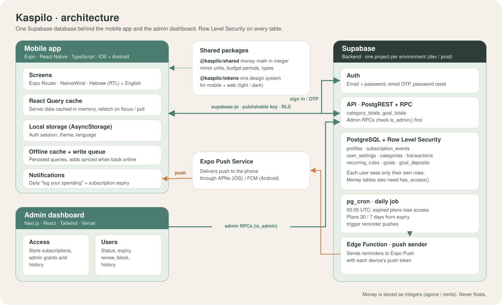

<div align="center">

# 🌿 Kaspilo

**A calm, bilingual personal-finance app. Track spending, plan budgets, save toward goals.**

Hebrew (RTL) + English · iOS + Android · light + dark


</div>

## About

Kaspilo helps people see where their money goes, with as little friction as possible. Adding an expense takes three taps: home → **Expense** → amount → category → save.

- **Home**: this month's spending, the balance left, and a card for each category with its budget bar. Over-budget categories turn red.
- **Stats**: donut charts by month or year for expenses, income and balance, with the change from the last period.
- **Goals**: savings goals with deposits. Deposits are kept apart from expenses.
- **Recurring and installments**: weekly, monthly and yearly entries, and payments split evenly.
- **Three languages**: Hebrew, English and Spanish, chosen from the phone's language.

Access is an in-app subscription (monthly or yearly, 14-day free trial) bought through the **App Store** or **Google Play**. An admin can also grant access by hand in the **admin dashboard**.

## Architecture

<p align="center">
  
</p>

| Layer | What it does |
| --- | --- |
| **Mobile app** | Expo Router screens, NativeWind styling. React Query caches server data. AsyncStorage keeps the session, theme and language. |
| **Admin dashboard** | Next.js on Vercel. Grants access, shows store subscriptions and analytics through admin-only RPCs. |
| **Supabase** | Auth (email, OTP, reset), PostgreSQL with Row Level Security on every table, RPCs for totals, `pg_cron` for daily expiry. |
| **Shared packages** | `@kaspilo/shared`: money math and budget periods. `@kaspilo/tokens`: one design system for both apps. |
| **Offline + notifications** | Offline cache with a write queue that syncs when back online. Push notifications (daily reminder, subscription expiry) via Edge Function → Expo Push. |

**Money is never a float.** Every amount is stored as an integer in minor units (agorot / cents) and formatted in one place.

## Repository

```
apps/mobile        Expo React Native app (iOS + Android)
apps/web           Next.js admin dashboard (Vercel)
packages/shared    Money math, periods, shared types (unit tested)
packages/tokens    Design tokens shared by both apps
supabase/          Migrations, seed, database tests
docs/              Product spec, prod setup, images
evals/             Prod readiness checklist
```

Product decisions live in [docs/spec.md](docs/spec.md).

## Getting started

Requires Node 20+ and npm (npm only, no yarn / pnpm).

```bash
npm install
```

```bash
npm run mobile
```

```bash
npm run web
```

Checks:

```bash
npm run typecheck
```

```bash
npm run lint
```

```bash
npm test
```

## Environments

Dev and prod are fully separate. Nothing is shared between them.

| | Development | Production |
| --- | --- | --- |
| Supabase project | dev project | separate clean project |
| App name | Kaspilo Dev | Kaspilo |
| Deep link scheme | `kaspilo-dev://` | `kaspilo://` |
| Bundle id / package | `com.kaspilo.app.dev` | `com.kaspilo.app` |
| Mobile env file | `apps/mobile/.env.development` | `apps/mobile/.env.production` + EAS `production` environment |
| Web env | `apps/web/.env.development`, Vercel Preview | Vercel Production |

Env files are gitignored. Copy each `.env.example` and fill it in.

- **Mobile:** `expo start` loads `.env.development`. EAS builds do not upload gitignored files, so set the same `EXPO_PUBLIC_*` variables in the matching EAS environment (`development`, `preview`, `production`). `APP_VARIANT` in [apps/mobile/eas.json](apps/mobile/eas.json) picks name, scheme and bundle id in [apps/mobile/app.config.ts](apps/mobile/app.config.ts).
- **Web:** on Vercel set the project root to `apps/web`, then add the three `NEXT_PUBLIC_*` variables twice: Preview → dev project, Production → prod project. A production build with missing variables fails on purpose.
- **Root `.env`:** only for local scripts that need the secret key (seeding dev users). The apps never read it.

## Security

- Row Level Security on every table: a user sees only their own rows.
- Subscription status is written only by admin RPCs or the daily cron, never by the client.
- Apps use the publishable key only. The secret key never goes in `apps/` or any `EXPO_PUBLIC_` / `NEXT_PUBLIC_` variable.

## Going to prod

Pass [evals/prod-readiness.md](evals/prod-readiness.md) first.
